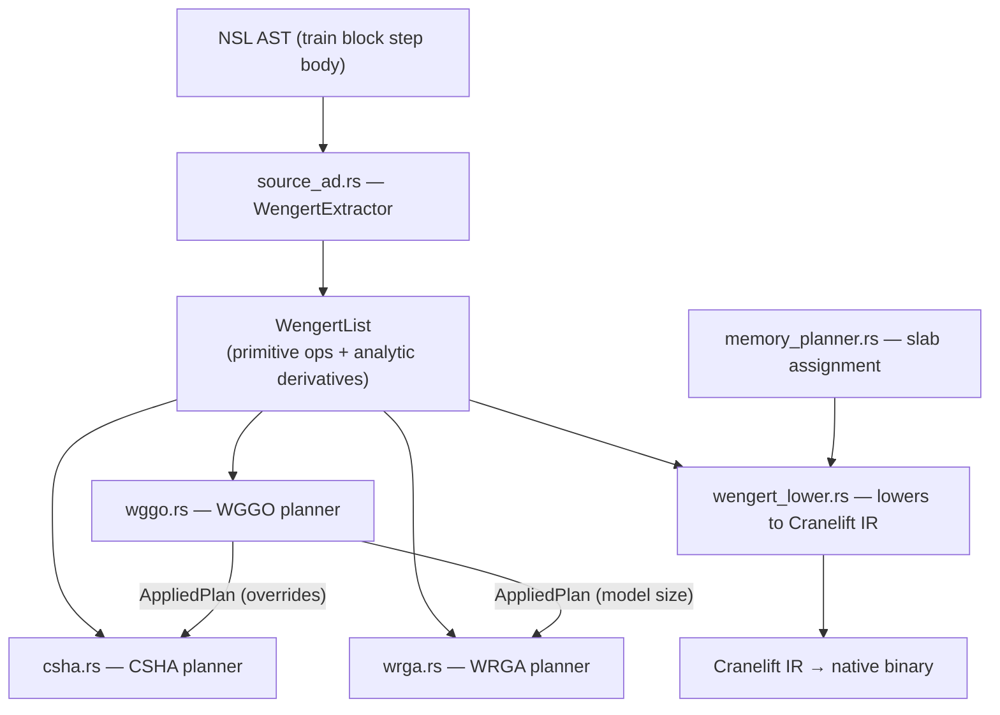

<!-- owner: @bwiemz -->

# Optimization Passes

NSL's compile-time optimization passes are the reason programs outperform a naive PyTorch transliteration. Each pass is an IR rewrite or a specialized code-synthesis step that runs before Cranelift emits the final binary. This page explains which passes exist, why they run in the order they do, and how to add a new one.

For the surrounding compiler stage, see [Compiler-Pipeline § Stage 4](Compiler-Pipeline.md#stage-4--codegen). Remember: **Cranelift is the sole function-emission backend**; passes described here either (a) rewrite the IR that Cranelift consumes, or (b) synthesize PTX text that gets embedded as a Cranelift data section.

## AOT autodiff — the WengertList

Source: [`crates/nsl-codegen/src/source_ad.rs`](../../crates/nsl-codegen/src/source_ad.rs).

NSL has **two** autodiff paths:

- **AOT (ahead-of-time) source AD** — `source_ad.rs` (`WengertExtractor`) walks the AST of a `train` block's step body and builds a `WengertList` (a straight-line SSA DAG of primitive ops plus their analytic derivatives) at compile time. The `WengertList` is then lowered by [`wengert_lower.rs`](../../crates/nsl-codegen/src/wengert_lower.rs) into **Cranelift IR** (as FFI calls into the NSL runtime). This is the fast path; dead-gradient elimination (`eliminate_dead_gradients`, `eliminate_by_backward_live`) prunes adjoint ops that contribute nothing to any trainable parameter.
- **Tape-based dynamic AD** — the fallback for constructs `source_ad.rs` cannot prove (dynamic shapes, data-dependent control flow). The step body falls back to `compile_tape_backward`. Slower; the downstream `WengertList` passes (WGGO, CSHA, WRGA) do not apply because no `WengertList` is produced. See [Runtime-Internals § Autodiff tape](Runtime-Internals.md#autodiff-tape) for raw pointer lifetime discipline.

When source AD extraction succeeds, the `WengertList` becomes the shared input for every downstream optimization pass (WGGO, CSHA, WRGA).



Note: `WengertList` does NOT lower to PTX. Subsystem fusion passes (CSHA, WRGA, FlashAttention-2) synthesize PTX separately via their own templated emitters — see the per-subsystem sections below.

> **Diagram scope:** The diagram shows WengertList consumers only; FASE planning runs before source AD, and the diagram omits CPDT's `AppliedPlan` consumption — see per-pass sections below for the full picture.

## Memory planning — the slab allocator

Source: [`crates/nsl-codegen/src/memory_planner.rs`](../../crates/nsl-codegen/src/memory_planner.rs).

M36 (compile-time memory planning) solves a liveness-based packing problem over the full program AST:

1. **`analyze_ast_liveness`** — walks the AST to find every static-shape tensor allocation and record its live interval (birth program-point to last-use program-point).
2. **`InterferenceGraph::build`** — constructs an interference graph where nodes are tensors and edges connect tensors that are simultaneously live.
3. **`plan_slab`** — colors the interference graph greedily; assigns each tensor a contiguous offset inside a single GPU memory slab. Non-interfering tensors share memory.
4. At program startup the slab is initialized by a single `nsl_gpu_slab_init` call (see [`compiler/main_entry.rs`](../../crates/nsl-codegen/src/compiler/main_entry.rs)); per-tensor offsets are constant-folded into the emitted Cranelift IR.

The memory planner runs **after** `compile_user_functions` and **before** `compile_main` (see [`compiler/entry_points.rs`](../../crates/nsl-codegen/src/compiler/entry_points.rs)). This sequencing is load-bearing: the slab plan must be complete before `compile_main` emits the initialization call.

**Verification target: 0 MB/step allocation growth.** If your change regresses this, the slab plan is incorrect. Use [`memory_timeline.rs`](../../crates/nsl-codegen/src/profiling/memory_timeline.rs) to inspect per-step allocation events. The `--memory-report` flag (`check_vram_budget` / `format_memory_report`) surfaces the slab summary at build time. A non-zero per-step delta in `--memory-report` output indicates the slab plan is missing a tensor; the build still succeeds, but the runtime allocator will repeatedly grow. Detect by diffing `--memory-report` output across commits or by running `nsl profile` and checking the `memory_timeline` section for a flat plateau rather than stable zero-growth.

## Pass ordering

The optimization passes that operate on the `WengertList` run inside `compile_train_block` (invoked from `compile_main`). The order, as read from [`crates/nsl-codegen/src/stmt.rs`](../../crates/nsl-codegen/src/stmt.rs), is:

1. **FASE planning** — `fase::plan` / `fase::plan_with_overrides` is called **first**, before source AD, using `wggo_overrides` stashed by a prior WGGO run (or `None` on a fresh compile). Produces a `FasePlan` describing accumulation mode, update rule, and two-phase clip structure. FASE codegen (applying the plan) fires later in the same function.
2. **Source AD extraction** — `WengertExtractor::extract_stmts` builds the `WengertList`.
3. **Calibration** — only through the library entry `nsl_codegen::compile_and_calibrate`, which runs the calibration harness and populates `calibration_sidecar` (feeding gradient-importance scores to WGGO). No `nsl build` path calls it, so the CLI refuses `--calibration-data` and the other calibration flags rather than ignoring them.
4. **WGGO** — `wggo::run_on_wengert_with_weights`; consumes the `WengertList` and emits a `WggoPlan` + `AppliedPlan`. Stashes `WggoOverrides` for all downstream passes (and for the NEXT compile's FASE planning).
5. **CSHA** — `csha::run_on_wengert`; consumes the `WengertList` + `WggoOverrides`; emits a `CshaPlan` and bridges it into kernel-site annotations (the `csha_bridge` channel — see the pass bus below).
6. **WRGA** — `invoke_wrga_if_enabled`; consumes the `WengertList`; runs dead-gradient elimination (`wrga_prune`), rank allocation (`wrga_roofline`), memory planning (`wrga_memory`), and fusion decisions (`wrga_fusion`).
7. **CPDT** — `invoke_cpdt_if_enabled`; consumes the `AppliedPlan` from WGGO **when one exists**. It does NOT require one: with no `AppliedPlan` it plans weights-only, which is the path a `distill` block and a loop-bound `train` block take. See the CPDT section below.
8. **Source-AD adjoint generation + lowering** — `AdjointGenerator` rewrites the pruned `WengertList` into an adjoint program; `wengert_lower` lowers it to Cranelift IR.
9. **CCR (Compiler-Chosen Recomputation)** — straddles step 8. Its *planning* half (`ccr::plan`, `select_partition_dp`) runs on the PRIMAL tape before `AdjointGenerator`, segmenting per transformer block and classifying each result as escaping or interior; its *rewriting* half (`apply_budget`, `apply_to_adjoint`, `splice_decompress`, `insert_adjoint_last_use_frees`) reads the generated adjoint to see which interiors the backward needs, then early-frees the interiors and splices recompute clones into it. Driven by `--checkpoint-blocks` / `--checkpoint-stride`; see the per-pass description below.
10. **Memory planner (M36)** — runs after all user-function bodies are compiled, before `compile_main`. See above.

**Pass ordering is load-bearing.** FASE planning reads `wggo_overrides` from the compiler state, which is set by a prior WGGO run — on a fresh first-pass compile, FASE falls back to `fase::plan` (no overrides). CSHA receives WGGO's `AppliedPlan` (via `WggoOverrides`) so per-layer fusion-level decisions from WGGO are honoured — or rejected with a diagnostic — by CSHA. CPDT does NOT hard-depend on WGGO — `invoke_cpdt_if_enabled` gates on `cpdt_mode` and a configured cluster, and publishes `cpdt_plan` on the weights-only path with `--wggo` absent (pinned by `cpdt_moment_precision_gate::cpdt_without_wggo_activates_weights_only`). What IS ordering-sensitive is that the moment-precision consult must read the channel AFTER it is published; publishing it late is the defect that made CPDT-sourced precision structurally dead until #462/#466 made it visible. The memory planner (M36) must run after `compile_user_functions` and before `compile_main`; reversing this order means the slab-initialization call is emitted before the plan is computed.

## Observing which passes ran (`NSL_PASS_TRACE`)

Set `NSL_PASS_TRACE=1` on any `nsl build` / `nsl run` / `nsl check` / `nsl test` and the compiler prints a `[pass-trace]` report to **stderr** just before it exits. It answers two questions the pass registry cannot: *was this pass reached*, and *what did it do*.

```
$ NSL_PASS_TRACE=1 nsl run --source-ad --wggo full model.nsl
[pass-trace] 2 pass(es) ran: WGGO(OnWengert)@KernelPrepass -> FASE(PreExtraction)@TrainBlock
[pass-trace] did not run: CCR, CSHA, WRGA, CPDT, PCA, CPKD, CEP, CFIE, MemoryPlanner
[pass-trace] WGGO: applied, 3 rewrite(s)
[pass-trace] FASE: applied, 2 rewrite(s)
```

The three kinds of line, and why each exists:

- **`N pass(es) ran: …`** — the passes actually reached, in first-invocation order, each tagged `NAME(DeclaredStage)@ObservedPhase`. A flag that enables a pass which never runs produces a clean, plausible, wrong build; this line is what makes that visible. The `@Phase` half is the driver scope the pass was reached from, and is `unattributed` for a pass that ran outside every declared scope — which is how a NEW driver announces itself instead of being discovered months later.
- **`did not run: …`** — the registered passes that were never reached. The absence is the interesting half: a report showing only what happened would make "nothing ran" indistinguishable from "the trace is broken".
- **`NAME: <disposition>`** — one line per pass that reported an *effect*. `applied, N rewrite(s)`; `declined, <category> - <detail>` where the category is one of `mode off` / `no candidates` / `precondition violated` / `feature disabled` / `budget infeasible`; or `advisory only` for a pass that produces a report nothing consumes (CEP's architecture search, CPKD's build report).

The distinction between the second and third kinds is the point of the disposition. Before it, "CSHA did not run" and "CSHA ran and found no attention chain it could fuse" were the same line, and only one of them is a bug. A pass that changed nothing reports a **decline with a reason**, never `applied, 0` — a hard-coded zero is exactly what a broken counter looks like, so zero is not how "nothing happened" is spelled.

Two things the trace deliberately does not do:

- It does **not** infer effect from invocation. `nsl check --training-report` builds its report BY running the FASE and PCA planners, so those are reported as having run — accurate under this definition, but "ran" must not be read as "affected the emitted program". The disposition line is what says that.
- It does **not** change the build. The whole mechanism is two compiler-side vectors of `Copy` data; nothing is emitted into the compiled program. `crates/nsl-cli/tests/pass_trace_gate.rs` pins that by comparing loss streams with the trace on and off.

Implementation: [`crates/nsl-codegen/src/pass_trace.rs`](../../crates/nsl-codegen/src/pass_trace.rs), printed from `emit_pass_trace` in [`crates/nsl-cli/src/commands/build/mod.rs`](../../crates/nsl-cli/src/commands/build/mod.rs).

## How passes reach each other: the pass bus (`[pass-bus]`)

The trace above answers *which passes ran*. It does not answer how one pass's
output reaches another. That happens through the **pass bus**: twelve channels
on `compiler.bus`, each filled by exactly one pass and read by later stages.

| Channel | Producer | Read by |
| --- | --- | --- |
| `csha_bridge` | CSHA | the FlashAttention call site, Wengert lowering |
| `csha_claimed_ops` | CSHA | `Compiler::is_csha_claimed` |
| `csha_backward_claims` | CSHA | the source-AD reverse walk, CCR's claim exemption |
| `wrga_plan` | WRGA | adapter init/inject, `compile*_returning_plan` |
| `adapter_sites` | WRGA | adapter rewrite, synthesized-field access |
| `cpkd_plan` | CPKD | the distillation build report |
| `cpdt_plan` | CPDT | the precision-adaptive optimizer path |
| `cfie_plan` | CFIE | the build report |
| `cfie_serve_gen` | CFIE | the `generate()` rewrite |
| `wggo_overrides` | WGGO | FASE recipe selection, the per-parameter mode table, CSHA's and WRGA's inputs |
| `wggo_preplans` | WGGO | kernel synthesis, the train-block driver |

These are the edges a future pass *manager* would order by, and the
pass-to-pass subset is now **declared**: where a channel's value feeds another
pass's planning, its descriptor names that pass in `consumed_by_passes`
(`wggo_overrides` → FASE, CSHA, WRGA). `PipelineStage` cannot do that job —
`WGGO(OnWengert)` runs before `FASE(PreExtraction)` because a different driver
invokes it — but a data dependency orders by construction.

Each declared edge carries an `OrderClaim`, and the distinction it draws is
not decoration: for CSHA and WRGA, "WGGO is invoked first" genuinely holds
whenever both run, and the report checks it (`DEPENDENCY ORDER` line on
violation). For FASE it is **false** — a train block whose pre-plan is missing
or fingerprint-rejected re-invokes WGGO *in place*, after FASE already planned
— so that edge claims only the value-level order, with a different guard per
path: on the rejected-pre-plan path FASE consumed the pre-pass publish and the
driver hard-refuses if the replan diverges from it; on the missing-pre-plan
path FASE read the channel empty and fell back, so no mode table exists to go
stale. The `STAGE ORDER` line uses the same edges in the other direction: an
inversion is attributed to its edge (*required by* for an invocation-ordered
edge, *consistent with* for a value-ordered one) — and only when the channel
actually published, because a producer that ran and declined carried nothing,
and attributing the inversion to it would be a false explanation.

The same `NSL_PASS_TRACE=1` prints one line per channel that saw traffic:

```
[pass-bus] csha_bridge: published 1x by CSHA, read 5x full, 0x empty
[pass-bus] wrga_plan: published 0x by WRGA, read 0x full, 3x empty
```

`full` reads got a value; `empty` reads found the channel unfilled and took
their fallback branch. Channels with no traffic at all are omitted. Two
patterns are reported as findings rather than counts:

- **`DEAD OUTPUT`** — a pass filled a channel and nothing ever read a value out
  of it. The pass computed something for nobody. This tree has produced that
  defect repeatedly (an autotuner chooser with zero production callers; a
  certification gate silently off), and it was previously only ever found by
  someone grepping.
- **`SILENT DEFAULT`** — a consumer read an empty channel *although the
  producing pass ran and reported applying a transformation*. Every consumer's
  `None` branch is a working fallback, so this is invisible from every layer
  above; the finding names the channel and says what the fallback does.
- **`READ BEFORE PUBLISH`** — a consumer read the channel empty *before* its
  first publish, and the value then arrived later in the same process: the
  early reader planned against the fallback while a real value existed
  downstream of it. This is the ordering question at read granularity — the
  totals alone cannot distinguish ask-before-answer from the benign
  interleavings, which is what the sequence stamps on the counters are for.
  Channels where the tree does this deliberately — or where the
  process-scoped stamps defeat the per-compile ordering argument (a
  multi-file build compiles library modules, each reading some channels
  empty, before the entry compile publishes) — are exempt with the mechanism
  recorded (`wggo_overrides` under the in-place replan; `wrga_plan`,
  `cfie_plan` and `wggo_preplans` under multi-module builds; the CPDT
  moment-precision read, a wart the analysis surfaced and recorded rather
  than silently blessed: it structurally precedes its own train block's
  publish, and only an earlier train block's never-cleared plan can feed it).

`SILENT DEFAULT` deliberately does **not** fire when the producer merely ran: a
pass that runs and *declines* leaves its channel empty by definition, and that
decline is already reported on its disposition line. Only the contradiction —
applied, yet empty — is a finding.

Fields on the bus are private to `pass_bus.rs`, so the accessors are the only
way to reach a channel and the counts cannot be incomplete. Adding a channel
without declaring it fails
[`pass_bus_drift.rs`](../../crates/nsl-codegen/tests/pass_bus_drift.rs).

Implementation: [`crates/nsl-codegen/src/pass_bus.rs`](../../crates/nsl-codegen/src/pass_bus.rs).

## The fused LM head (`--fuse-lm-head`)

The fused linear-CE kernel replaces `matmul(x, transpose(W)) [+ bias] →
cross_entropy` with one op, so the `[batch*seq, vocab]` logits and their
gradient are never materialized. On Coder-50M that surface is 1024 × 49152
floats per step, and removing it is worth ~8.5% of step time.

Reaching it used to require writing four numbers the compiler already knows
onto the train block:

```
@fused_lm_ce(enabled=true, vocab_size=49152, hidden_size=512, batch_size=1, seq_len=1024)
train(model=m, ...):
```

No production pretraining script in this repo carried that decorator — only
`models/benchmarks/mfu_bench.py`, which *generates* it into a throwaway
program. `--fuse-lm-head` closes the gap by deriving all four:

| number | derived from |
| --- | --- |
| `vocab_size`, `hidden_size` | the LM-head weight's declared dims (`model_field_dims`, from a shape-literal initializer or a `Tensor<[..]>` annotation) |
| `batch_size`, `seq_len` | the `DataLoader(...)` construction — every keyword there is already required to be a compile-time constant |

Three modes. `off` (the default) never infers; an explicit `@fused_lm_ce` still
works. `auto` infers where the chain and the shapes can be proven and falls
back to the composite path with a `[lm-head-fusion] declined:` line where they
cannot. `require` makes that fallback a compile error — for a lane that would
rather not discover at step 40,000 that it has been paying for the logits
surface all along. `--pretrain-optimized` selects `auto`.

**An explicit decorator always wins, including `enabled = false`**, which is a
deliberate opt-out inference must not overturn. `--training-reference` forces
the mode off: the reference arm is what the fused numerics are validated
against, so it must not contain the fusion it is a baseline for.

### The runtime shape read

Every pretraining script here flattens the logits like this:

```
let ls = logits.shape
let flat_logits = logits.reshape([ls[0] * ls[1], ls[2]])
```

That `.shape` is a live consumer of the `[B, S, V]` logits, so the fusion
cannot delete them. Since the compiler has just proven `B`, `S` and `V`, it
answers the read directly — the op becomes a `Passthrough("const_shape:B,S,V")`
that builds the identical list `nsl_tensor_shape` would have returned, and the
tensor becomes dead. Without this, `--fuse-lm-head` would fire only on programs
that already hard-code their dims, which is none of the ones this repo ships.

Only the PRE-reshape chain members are folded, and only when the matcher
descended through a reshape (the same fact that sets `x_rank3` on the emitted
op). A rank-2 `[B*S, V]` logits tensor makes `ls[2]` an out-of-bounds read, so
any program written this way already required rank-3 logits to work at all.

### What inference does not change

The substitution itself is the pre-existing one. Measured on Coder-50M,
195 steps, seed 1: an inferred head is **bit-identical** to the same head under
an explicit `@fused_lm_ce` decorator, and the composite-vs-fused divergence
(3.7e-2 relative by step 185, from the fused dW's atomic/GEMM-order
accumulation) is identical for both routes. Inference selects a certified
path; it does not add a second one.

Gates: `crates/nsl-cli/tests/lm_head_inference_gate.rs` (which decision was
made, including that `models/coder50m/pretrain{,_cert}.nsl` still infer),
`crates/nsl-codegen/src/lm_head_inference.rs` unit tests (the DataLoader scan),
`crates/nsl-codegen/tests/fused_linear_ce_numerical.rs` (the kernel itself).

## The placed transient arena (`--transient-arena`)

Backward temporaries normally flow through the runtime caching allocator,
which recycles well but gives a tensor a different address whenever the
free-list happens to differ — and address stability is the precondition for
CUDA-graph replay. `--transient-arena` gives a conservative subset of
backward temporaries fixed, planned device addresses.

Three stages, all in `crates/nsl-codegen/src/transient_arena.rs`:

1. **Shape propagation.** Dims (not element counts — a matmul's output numel
   is a function of the *shapes*) propagate through the `[forward ; adjoint]`
   tape from three seed sources: semantic-typed dims, model-field initializer
   dims — including dims recovered by **constructor-argument folding**
   (`ctor_fold.rs`: `randn([d_model, d_ff])` under `SwiGLUFFN(512, 1408, …)`
   folds to `[512, 1408]`), and the `--fuse-lm-head` DataLoader proof for the
   `[batch, seq]` batch fields. A constant lattice folds the house shape
   idioms (`let s = x.shape; x.reshape([s[0]*s[1], nh*hd])`,
   `int(self._n_heads.item())`) so the attention stack's runtime-value
   reshapes resolve statically. Where dims die at a runtime-shaped op the
   element *count* still carries (`SizeInfo::Numel`), and can even cross a
   matmul against a rank-2 weight of known shape. On coder50m this sizes
   1456 of 2159 tape values; the numel-only pass it replaced sized effectively
   none (every elementwise chain sits downstream of a matmul).

2. **Admission.** An allowlist, not a denylist. Placeable ops must be
   backward-region, statically sized, not saved-for-backward, not
   tape-escaping, non-aliasing, in the single-allocation elementwise family —
   AND survive two rules that model measured runtime behavior: an op whose
   input **dies at it** is refused (`can_mutate_inplace_gpu` mutates a dying
   uniquely-owned input in place and allocates nothing), and a binary without
   provably equal operand shapes or with a view operand is refused (the
   broadcast/fallback routes allocate off the straight-line path). Both rules
   were found by the bind/placement reconciliation, not by inspection.

3. **Placement.** Sequential disjoint regions — deliberately not the M36 BFD
   time-sharing engine, whose shared offsets alias under the runtime's
   `payload = base + offset + REDZONE·(idx+1)` layout (caught by byte-identity
   bisection: losses diverged at step 1 from slot 8 on). Every payload pair is
   separated by exactly one 256-byte `0xA5` red zone.

The runtime half (`crates/nsl-runtime/src/transient_arena.rs`) arms a
single-shot, size-exact **pin** immediately before each admitted op and
disarms it immediately after. The pin fires only on an allocation of exactly
the planned size, so a wrong compile-time size degrades to a loud warning and
a heap fallback, never corruption; teardown reconciles binds against
placements and fails visibly on drift. Validation knobs: `NSL_ARENA_CHECK=1`
verifies every red zone at each step's end, `NSL_ARENA_SLOT_LIMIT=k` places
only the first `k` slots (bisection), `NSL_ARENA_DEBUG=1` prints seed/refusal
provenance at compile time and pin diagnostics at runtime.

Validated on coder50m (40 steps, `--deterministic --seed 4242`): planned and
unplanned runs produce **byte-identical** loss streams and `.nslm`
checkpoints; 7240 of 7240 binds placed; per-step guard checks clean.

**Composition with `--cuda-graphs` (measured 2026-08-07):** the arena's
pinned addresses feed graph capture *by construction* — the allocator pin
returns the same pointer every step, which is exactly what the recorder's
digest-stability streak wants — so no separate "offset feeding" mechanism
exists or is needed. On coder50m the composed run is byte-identical to
eager, reconciles all binds (0 misplaced — the precondition for a captured
graph never baking a scratch address), and stabilizes capture one window
earlier than graphs-alone (36 vs 35 replays). On the canonical
`cuda_graph_gate.nsl` fixture the arena admits **zero** transients (they
are exactly the refused classes: forward-region, unsized, tape-escaping),
so there is no delta there — capture-coverage growth on real models is
bounded by readback taints and admission breadth, not address stability.
`scripts/arena-parity.sh` gates the composition (byte-identity, capture
non-vacuity, replays ≥ graphs-alone, `0 misplaced`).

Gates: `crates/nsl-codegen/src/transient_arena.rs` unit tests (per-rule
admission cases, shape-rule semantics, packing non-overlap),
`crates/nsl-cli/tests/transient_arena_gpu_gate.rs` (report plumbing),
`crates/nsl-runtime/src/transient_arena.rs` unit tests (pin exactness).

## Weight-aware compilation (`-w weights.safetensors`)

`nsl run -w FILE` and `nsl build -w FILE` do two things with a safetensors
file, and the second is only correct because of the first.

**1. The program runs with the file's values.** Every model constructor
copies the file's tensors into the parameters the file names, in place,
before the constructor returns, so no user code can read a parameter before
it is loaded. `main` opens the file (memory-mapped) before anything else. In
the constructor of a model `M`, a parameter is looked up by:

| Parameter | Names tried, in order |
|---|---|
| a tensor field `f` of `M` | `M.f`, then `f` |
| a parameter of a nested model or model array | its path from the instance, as `model_save` spells it (`blocks[0].w`), then dotted (`blocks.0.w`) |

A nested model's own constructor runs first, so the enclosing model's
path-named tensor is the one that stays. F16, BF16, F32 and F64 tensors are
converted to the field's float width. A shape that differs from the field's
is an error (at compile time when the field's shape is a literal, otherwise
when the constructor runs), with one exception: a bare name `f` that more
than one parameter could claim (another model has a tensor field `f`, or the
file also holds a tensor whose name ends in `.f`) is loaded where the shapes
agree and skipped where they do not. A tensor that no parameter of a model
the entry module defines or imports could be loaded from is listed in the
report. Adapter tensors (`@adapter`) are not
model fields and are not loaded by `-w`; a base-only file loads into a model
with adapters, as it does through `model_load`.

**2. Code may be specialized on the values of parameters that are never
written.** The value-dependent rewrites are constant folding of a product or
sum of two weights (`[nsl] M52b: constant-folded ...`) and elimination of a
matmul by a near-identity weight (`[nsl] M52b: eliminated near-identity
matmul ...`). Each is made only when the parameter holds the file's values
for the whole run:

- the build loads the file (`-w` on `nsl run` or on an `nsl build` that
  produces an executable; not `nsl check`, a shared library, or a weights
  file the compiler found through `load_safetensors("...")` in the source,
  which stay inputs to planning only);
- nothing in the program writes the parameter after it is loaded. A `train`,
  `distill` or `quant` block, a `model_load` or `from_hf`, a model with
  `@quantize`, any in-place tensor operation (`copy_data`, `copy_`,
  `*_inplace`) or an element store through a variable (`t[i] = v`, which
  includes a `kernel` storing to an argument) counts as writing every
  parameter; an assignment to a field (`m.w = ...`, `self.w += ...`) counts
  as writing every field of that name. A `grad` block counts too: dropping
  `x @ W` would drop W's gradient. The analysis is over the whole program
  (every module, called or not), and whatever it cannot rule out is a write;
- one tensor, and only one, can reach the field: the file holds no other
  tensor whose name ends in the field's name, and for a bare name no other
  model has a tensor field of that name;
- the rewrite rests on the file's exact values. `--dead-weight-threshold`
  (1e-6 by default) is a tolerance: dead-weight elimination zeroes values
  below it in the compiler's copy of the file, and a weight within it of the
  identity would count as the identity. A rewrite uses those approximations
  only when the threshold is passed explicitly (`nsl build
  --dead-weight-threshold 1e-6 -w ...`; `nsl run` has no such flag), and the
  report line says which basis it used (`..., from the file's exact values`
  or `..., from values within the --dead-weight-threshold 1e-6 given`).

A folded constant is computed in f64 and, when the program runs, converted
to the dtype and device of the parameters it replaces (a BF16 file loads
into the model's f32 fields; the model may be on a GPU). Shapes the fold
does not implement (a broadcast sum, a matmul that is not 2-D) are left to
the runtime.

A rewrite that is refused is not an error. The ordinary code is compiled,
and the report says which parameter and why:

```
[nsl] weight-aware: 'Toy.w' is loaded from the file's 'w'
[nsl] weight-aware: not specialized on 'w' (near-identity matmul elimination skipped): the program has a train block, which updates parameters
```

Shape specialization (reading a dimension from the file) and the planners
that take the file as an input (CPDT, WRGA, CEP, KV-cache quantization) are
not affected by any of this, except that a program planned from the file now
also runs with it: `nsl run --cpdt full -w FILE` used to choose each block's
moment precision from the file's magnitudes and then train from the model's
initializer.

**3. A specialized program is tied to the file.** The compiler records the
SHA-256 of every stored tensor a rewrite was allowed to depend on (dtype,
shape and bytes; every tensor of the file when the program writes none, none
when it trains). At startup the program hashes those tensors as it finds
them in the file and refuses to run if one differs or is gone:

```
nsl: -w: the weights file '/data/model.safetensors' has changed since this program was compiled with it: parameter 'w' has different contents. The compiled code depends on that parameter's values, so it would compute wrong results with this file. Recompile with the file as it is now.
```

The digest of that list is also a key of the run's execution fingerprint
(`wspec=<16 hex digits>`, classed with the keys that change the arithmetic),
present only when the list is not empty. A program that specialized on
nothing, because it trains or reassigns its parameters, carries no hashes
and no key: it loads whatever the file holds when it starts, which is what a
fine-tuning run wants.

The path compiled into the program is the absolute path of the file given to
`-w`. `--standalone -w` is a different mechanism (the file is bundled into
the executable) and does no weight-aware compilation.

Limits. A folded constant is the f64 product rounded once to the
parameters' dtype, which can differ in the last bit from the product the
program would have computed. A one-element weight is no longer embedded as an
immediate (only tensor fields are loaded; the note says so). The weight-aware
sparse matmul that `NSL_M52C_SPARSE_MATMUL=1` used to enable has been removed;
a weight above the sparse threshold is only reported, and its matmul is dense.

Gates: `crates/nsl-cli/tests/weights_flag_binds_model_gate.rs` (loaded
values, refused rewrites, the startup check on a built program),
`crates/nsl-codegen/src/weight_aware.rs` unit tests (the write analysis, the
hash and the expectation table), `crates/nsl-runtime/src/weights_file.rs`
unit tests (header parsing, the mismatch message, dtype conversion).

## Per-pass descriptions

### CCR — Compiler-Chosen Recomputation

Source: [`crates/nsl-codegen/src/ccr.rs`](../../crates/nsl-codegen/src/ccr.rs). Research background: [`docs/research/CCR.pdf`](../../docs/research/CCR.pdf).

Block-granular activation checkpointing on the decorator-free source-AD path. The source-AD lowerer retains every primal intermediate until end-of-backward, so the activation wall is O(layers × per-layer intermediates); CCR converts it to O(layers × boundary tensors + one block's interiors). The pass:

1. **Segments** the flat inlined primal tape into per-transformer-block ranges using the same `blocks.N` parameter-name prefixes WGGO uses (`wggo_graph::layer_prefix`).
2. **Classifies** each in-segment result: *escaping* (consumed by a later primal op — the residual stream and anything else crossing the block boundary) stays SAVED; *interior* (consumed only inside the segment and/or by the adjoint) becomes RECOMPUTE.
3. **Early-frees** the original interiors, each at the end of its own segment during the forward (after the whole forward with `NSL_CCR_SEGMENT_FREE=0`). Under `--layerwise-accum` the accumulation window buffers the shape stubs of step 4 per micro-batch, with everything else the backward reads; under `--weight-stream` a segment's interiors are freed before its weights are evicted.
4. **Splices** clones of the interior-producing ops into the adjoint immediately before the first adjoint op that consumes them, remapping those consumers. Only an interior whose *value* the backward reads is cloned (`backward_reads`). One it reads for shape only — the operand of a residual add, read as the target of a `reduce_to_shape` — is not recomputed: a one-element shape stub captured just before the free stands in for it. One it does not read at all is simply freed.
5. **Frees** each recomputed tensor right after the last adjoint op that consumes it.

Recompute clones run the same kernels in the same order on the same inputs, so the transform is **bit-exact**. Ops with non-replayable semantics (Dropout and `randn` — RNG) are force-saved, and segments owned by a CSHA backward claim are exempted (the claim table is keyed by primal `OpId`, which a clone cannot satisfy).

Driven by `--checkpoint-blocks`, with:

- `--checkpoint-selective`: never recompute matmul-class ops. A plain matrix product the backward reads for shape only is still released at the end of its segment.
- `--checkpoint-stride N|auto|dp`: coalesce block anchors into super-segments. `N` is a fixed stride; `auto` searches uniform strides and `dp` non-uniform partitions against the projected block-activation peak (`project_activation_peak`), which counts the tensors computed inside the blocks and nothing else.
- `--checkpoint-budget-mib`: used once. At a fixed stride a knapsack flips the tensors that cost most to recompute (an operation count from their shapes, `recompute_ops`) back to SAVE within the budget; under `auto` and `dp` the number caps the projected peak instead.
- `--checkpoint-compress bf16` (with `--checkpoint-selective`): store the saved matmul-class activations as bf16, each cast at the end of its segment. Not bit-exact.

`auto`, `dp` and the budget need static tensor sizes. They come from literal shapes and from a DataLoader with literal `batch_size` and `seq_len` and `drop_last=true`, propagated through the forward (`ccr_static_sizes`); the build fails when they do not reach the block tensors. Codegen integration lives in `stmt_train/plan_ccr.rs` and `stmt_train/driver.rs`.

Fires: **source-AD backward only**, and only on models with `blocks.N`-style structure. On any other model, or without `--source-ad`, the build fails: a requested feature may not be silently inert.

---

### FASE — Fused Accumulation + Step + Epilogue

Source: [`crates/nsl-codegen/src/fase.rs`](../../crates/nsl-codegen/src/fase.rs) (core analysis), [`fase_optimizer.rs`](../../crates/nsl-codegen/src/fase_optimizer.rs) (update-rule description), [`stmt_fase.rs`](../../crates/nsl-codegen/src/stmt_fase.rs) (codegen integration), [`stmt_train/optimizer_step.rs`](../../crates/nsl-codegen/src/stmt_train/optimizer_step.rs) (the step, the clip of the window mean, and the flush of a trailing partial window).

Design specs: [`docs/superpowers/specs/2026-04-14-fase-deferred-codegen-integration-design.md`](../../docs/superpowers/specs/2026-04-14-fase-deferred-codegen-integration-design.md), [`2026-04-15-fase-codegen-phase2-design.md`](../../docs/superpowers/specs/2026-04-15-fase-codegen-phase2-design.md).

Given a `train` block configuration (optimizer, gradient accumulation count, clipping setting), `fase::plan` produces a `FasePlan` that the backward-codegen stage consumes. The plan describes: (1) whether to rewrite the backward at all (active only when `accumulation > 1`); (2) whether to run in **Deferred** mode (first-moment accumulation) or **Full** mode (standard gradient buffer, used when the optimizer does not match FASE invariants, e.g. Lion); (3) the mathematical update rule for the chosen optimizer, already specialised to the accumulation count; (4) the two-phase structure when `grad_clip` is enabled. The driver is pure — no state, no I/O — and produces the same output given the same inputs. The update rule is described by `fase_optimizer.rs` and lowered by `stmt_fase.rs`. A run whose micro-batch count is not a multiple of the accumulation count ends with one more step on the mean of the micro-batches its last window holds; a `--layerwise-accum` run cannot take that step and prints a warning instead (`NSL_FASE_FLUSH_TAIL=0` at compile time makes the ordinary schedule drop the tail too, for comparing the two). Under accumulation the `scheduler:` section counts micro-batches unless the train header says `schedule_unit = "optimizer_step"`.

Fires: **train-block only** (both planning and codegen run inside `compile_train_block`). The plan is a no-op (`FaseMode::Full` with N=1 scale) when `accumulation == 1`. Forward-only compilation and inference are unaffected.

---

### WGGO — Wengert Graph Global Optimization

Source: [`crates/nsl-codegen/src/wggo.rs`](../../crates/nsl-codegen/src/wggo.rs) (driver), plus sub-modules: [`wggo_cost.rs`](../../crates/nsl-codegen/src/wggo_cost.rs), [`wggo_dp.rs`](../../crates/nsl-codegen/src/wggo_dp.rs), [`wggo_gradient_scorer.rs`](../../crates/nsl-codegen/src/wggo_gradient_scorer.rs), [`wggo_apply.rs`](../../crates/nsl-codegen/src/wggo_apply.rs), [`wggo_conflicts.rs`](../../crates/nsl-codegen/src/wggo_conflicts.rs).

Research paper: [`docs/research/NSL-WGGO-Research.md.pdf`](../../docs/research/NSL-WGGO-Research.md.pdf).

The WGGO driver orchestrates eight stages (§5 of the research paper): (1) Wengert graph extraction (from `wengert.rs`); (2) cost-model annotation (`wggo_cost::build_lut`); (3) optional weight-analysis; (4) Level 1 inter-layer DP (`wggo_dp::solve`); (5) Level 2 per-layer ILP (greedy or templated solvers in `wggo_ilp`); (6) Level 3 kernel generation (delegated to backend); (7) memory planning (delegated to M36 `memory_planner.rs`); (8) communication schedule (`wggo_schedule::build_schedule`). The driver is pure data-in / data-out and has no backend side effects. It produces a `WggoPlan` (with embedded `AppliedPlan`) that all downstream passes consume as `WggoOverrides`. WGGO's `CoarseDecision::Prune` decisions are applied by the layer-to-residual-identity IR rewrite in `wggo_prune.rs`, wired at the train-block lowering site (source-AD only): a sub-block (`.attn` / `.ffn`) has its closure ops and residual Add deleted and its output aliased to its input, and a whole block (`LayerRole::Block`, `blocks.N`) is **chain-collapsed** — its residual Adds must form one stream chain `h0 → h1 → … → hk`, the closure and every Add are deleted, and `hk` is aliased to `h0` (spec §3.6). Each applied prune prints `[prune] layer=N name=… role=… applied=true closure_size=… ops_deleted=… residual_add_op=…`; a prune whose preconditions fail refuses the compile with a three-part `prune: …` error. The DP only emits `Prune` on its own below an importance floor production planning never fills, so a prune is requested explicitly with `--wggo-prune-layers` or `--wggo-layer-prune-fraction` (below).

Every figure in a plan (layer count, widths, head and KV-head counts, parameter bytes, batch and sequence length) is read from the model being compiled: the dims of its tensor fields and one-element config fields, and the batch shape of the step's inputs, propagated through the train block's tape (`wggo_model_shape.rs`). When some shape cannot be determined at compile time WGGO does not plan that train block: it logs `[wggo] not planned: …` with the reason and the downstream passes run as they do without `--wggo`. If a flag that only acts through the plan was passed (`--wggo-memory-budget`, `--wggo-moment-precision`, `--wggo-weights`, `--wggo-prune-fraction`, `--wggo-prune-layers`, `--wggo-layer-prune-fraction`) the same condition is a compile error.

Fires: **train-block, when `--wggo <mode>` is set.** Pure advisory on forward-only builds.

**CLI flags** (on `nsl build`, unless noted):

| Flag | Values / default | Effect |
| --- | --- | --- |
| `--wggo <mode>` | `full` \| `greedy` \| `off`; bare `--wggo` ⇒ `full`; absent ⇒ off | Selects the global-optimization mode. `full` runs the inter-layer DP + per-layer ILP + conflict resolution; `greedy` skips the ILP and re-costs the resolved config, escalating layers that regress > 5%; `off` runs each pass independently. |
| `--wggo-report` | off | Prints the global-optimization report to stderr, including the **Warnings / limitations** section (degradation notices, weights-load failures). |
| `--wggo-weights <path>` | none | A `.nslweights` sidecar for weight-based head-importance scoring. Each tensor is checked against the shape of the model's layer; a file from a model of another shape is a compile error. On load failure WGGO falls back to uniform scores and records a warning in the report. A weights file alone prunes nothing: head pruning needs `--wggo-prune-fraction`. |
| `--wggo-importance <mode>` | `auto` (default) \| `magnitude` \| `grad` | Head-importance scoring source. `auto` uses gradient scoring when a calibration sidecar is present, else magnitude; `grad` errors if no sidecar is present. |
| `--wggo-prune-fraction <F>` | `0.0` (no head pruning), clamped `[0.0, 0.9]` | Fraction of heads the `min_retained_importance` threshold may prune. Head pruning is opt-in: without a fraction above zero every head is kept, whatever the scores. |
| `--wggo-prune-layers <NAMES>` | none | Prune these layers, comma-separated, named as WGGO's layer graph names them (`blocks.1,blocks.3`). A whole block is chain-collapsed to an identity. An unknown name, or a layer with no residual identity (`other`, an embedding), is a hard error listing the graph's layers. Requires `--source-ad` and `--wggo <full\|greedy\|auto>`; refused on `@pipeline`. |
| `--wggo-layer-prune-fraction <F>` | none, `0 < F < 1` | Additionally prune the `floor(F × n)` of the `n` block layers with the lowest weight-magnitude importance: the RMS of each block's weights in `--wggo-weights` (names map to layers like `blocks.2.wq` or `m.blocks.2.wq`), normalized by the max; ties go to the lower layer index, and all `n` are never pruned. Refused without `--wggo-weights`, when a block has no weights in the file, and when `floor(F × n) = 0`. The `[wggo] layer-prune:` line prints the ranking. Same `--source-ad` / `--wggo` requirements. |
| `--devices <N>` | `1` | Cluster size (compile-time `world_size`). Drives WGGO's ZeRO-sharding budget — the DP only shards (`shard > 1`) when `N > 1` and memory pressure requires it. Unlike `nsl run --devices`, this spawns no processes; it only informs the plan. |
| `--explain-wggo` *(on `nsl profile`)* | off | Runs WGGO Full and emits a per-layer decision explanation covering all six dimensions: CEP (head prune), CSHA (fusion level), WRGA (adapter rank/placement), CPDT (optimizer precision), FASE (fused step), PCA (sequence packing). |

Full multi-GPU invocation with a report:

```sh
nsl build model.nsl --source-ad --emit-obj -o model_out \
  --devices 8 \
  --wggo full --wggo-report \
  --wggo-weights model.nslweights \
  --wggo-importance auto \
  --wggo-prune-fraction 0.3
```

If `--wggo full` is infeasible for the given `--devices` / memory budget, WGGO degrades **Full → Greedy → Off**, recording a warning at each step rather than silently producing an over-budget plan.

Pruning blocks explicitly, or the least important quarter of them by weight magnitude (the gate `crates/nsl-cli/tests/wggo_layer_prune_gate.rs` holds a pruned 4-block model bit-identical to the 3-block one):

```sh
nsl run model.nsl --source-ad --wggo greedy --wggo-prune-layers blocks.1,blocks.3
nsl run model.nsl --source-ad --wggo greedy \
  --wggo-weights model.nslweights --wggo-layer-prune-fraction 0.25
```

A pruned block's parameters receive no gradient, so the optimizer still allocates their state and (with decoupled weight decay) still decays them; the forward and backward simply no longer compute the block.

A layer prune is part of the checkpoint's execution record. The record gains `prune_layers=` (the sorted layer names) and `prune_frac=` (the fraction and a digest of the `--wggo-weights` file it ranks by), each only when requested. A resume that changes the prune is refused like any other arithmetic change: pruned onto unpruned, unpruned onto pruned, other layers, or other weights. An unpruned build still resumes checkpoints written before the keys existed.

---

### CSHA — Compiler-Synthesized Holistic Attention

Source: [`crates/nsl-codegen/src/csha.rs`](../../crates/nsl-codegen/src/csha.rs) (driver), plus sub-modules: [`csha_boundary.rs`](../../crates/nsl-codegen/src/csha_boundary.rs), [`csha_pipeline.rs`](../../crates/nsl-codegen/src/csha_pipeline.rs), [`csha_specialize.rs`](../../crates/nsl-codegen/src/csha_specialize.rs), [`csha_patterns.rs`](../../crates/nsl-codegen/src/csha_patterns.rs), [`csha_apply.rs`](../../crates/nsl-codegen/src/csha_apply.rs).

Research paper: [`docs/research/NSL-CSHA-Research.PDF`](../../docs/research/NSL-CSHA-Research.PDF).

Design specs: [`docs/superpowers/specs/2026-04-13-csha-tier-a-wiring-design.md`](../../docs/superpowers/specs/2026-04-13-csha-tier-a-wiring-design.md), [`2026-04-15-csha-tier-c-fused-backward-design.md`](../../docs/superpowers/specs/2026-04-15-csha-tier-c-fused-backward-design.md).

The CSHA driver orchestrates three passes (§3 of the research paper): (1) Level 1 boundary fusion (`csha_boundary`) — identifies adjacent attention sub-ops (RMSNorm, RoPE, matmul projections, softmax) that can be merged into a single tiled GPU kernel; (2) Level 2/3 pipelining/blocking (`csha_pipeline`) — selects tile configurations and SMEM budgets using a roofline model; (3) per-layer specialization (`csha_specialize`) — applies weight-aware and head-count-aware tuning. The driver is pure data-in / data-out; it receives `WggoOverrides` and honours (or rejects with a diagnostic) any per-layer fusion-level decision WGGO made. The resulting `CshaPlan` is bridged into the `csha_bridge` channel so FlashAttention-2 call sites can route CSHA-active layers through CSHA-aware FFI. Synthesized FlashAttention-2 PTX (forward + backward) is emitted by [`compiler/kernel.rs::maybe_synthesize_csha_training_ptx`](../../crates/nsl-codegen/src/compiler/kernel.rs) and embedded as Cranelift data sections.

Fires: **`@flash_attention`-annotated models inside `@train`, when `--csha <mode>` is set.**

---

### WRGA — Wengert-Pruned Roofline-Guided Adaptation

Source: [`crates/nsl-codegen/src/wrga_prune.rs`](../../crates/nsl-codegen/src/wrga_prune.rs) (Innovation 1 — dead gradient elimination), [`wrga_roofline.rs`](../../crates/nsl-codegen/src/wrga_roofline.rs) (Innovation 2 — roofline-guided adapter kind selection), [`wrga_spectral.rs`](../../crates/nsl-codegen/src/wrga_spectral.rs) (Innovation 3 — randomized-SVD rank allocation), [`wrga_fusion.rs`](../../crates/nsl-codegen/src/wrga_fusion.rs) (Innovation 4 — fusion-integrated adapters), [`wrga_memory.rs`](../../crates/nsl-codegen/src/wrga_memory.rs) (Innovation 5 — activation-sharing memory planner). The WRGA driver that sequences these is invoked via `invoke_wrga_if_enabled` in [`stmt.rs`](../../crates/nsl-codegen/src/stmt.rs). Adapter-site pre-scan and model-method body rewrite are in [`wrga_prescan.rs`](../../crates/nsl-codegen/src/wrga_prescan.rs).

Research paper: [`docs/research/NSL-WRGA-Research.PDF`](../../docs/research/NSL-WRGA-Research.PDF).

Design specs: [`docs/superpowers/specs/2026-04-13-wrga-milestone-b3-design.md`](../../docs/superpowers/specs/2026-04-13-wrga-milestone-b3-design.md), [`2026-04-19-wrga-b32-option3-revised-design.md`](../../docs/superpowers/specs/2026-04-19-wrga-b32-option3-revised-design.md).

What trains and what is adapted comes from two decorators. `@freeze(include=|exclude=)` leaves frozen parameters out of the train block's parameter list. `@adapter(type=lora|ia3|gatedlora, target=["Class.field"], rank=, alpha=)` adds an adapter to the named weight of every instance of the class, wherever it is defined (the module that carries the decorator, or one it imports, such as the standard library's `Linear`): [`wrga_adapter_inject.rs`](../../crates/nsl-codegen/src/wrga_adapter_inject.rs) resolves the target, [`wrga_adapter_init.rs`](../../crates/nsl-codegen/src/wrga_adapter_init.rs) builds the adapter tensors in the model's constructor, sized from the weight, and [`wrga_adapter_rewrite.rs`](../../crates/nsl-codegen/src/wrga_adapter_rewrite.rs) rewrites `x @ self.w` or `x @ self.w.transpose(0, 1)` into the adapted form. A target that resolves to no weight, or to a weight no matmul uses, is a compile error, and so is a weight named by more than one target (two `@adapter` decorators, or one listing it twice): a weight takes one adapter. `model_save` and `model_load` carry the adapter tensors after the model's own.

`@wrga(mode=auto|manual, budget=, target=)` adds an analysis of the train block, printed by `nsl build --wrga-report` and `nsl check --wrga-analyze`. It chooses nothing: the adapters are the declared ones, in either mode (`mode=hybrid` is refused). `budget=N` is a compile-time cap on the parameters the declared adapters hold. The analysis has five stages. `wrga_prune` reports how much of the backward pass the frozen parameters remove, against a backward pass with every parameter trainable; the removal itself is done by the source-AD pass `eliminate_dead_gradients`, with or without WRGA. `wrga_roofline` classifies each site against the target GPU's roofline; it has no activation shapes, so every site is costed at one sequence of 128 tokens, at which every matmul is memory-bound on every GPU in the table. `wrga_spectral` computes each checkpoint weight's effective rank with a randomized SVD and, when the program declares no adapter, suggests ranks under the budget; the suggestion sizes nothing. `wrga_fusion` marks the sites a fused kernel exists for. `wrga_memory` counts the activations saved for the backward pass; all of them are live when it starts, so none can share a slot.

Fused LoRA, gated-LoRA and IA³ kernels are synthesized by [`wrga_fused_ptx.rs`](../../crates/nsl-codegen/src/wrga_fused_ptx.rs) and registered at startup via `emit_fused_ptx_registration`. They are used only with a pinned target (`--target sm_80` or later) and `NSL_WRGA_FUSED_CUDA=1`, compute in half precision including the base product, are right for one output tile only (at most 16 activation rows, 8 output columns and rank 8; the runtime runs the ordinary operations for anything larger and says so), and measured slower than the ordinary operations, which are the default.

Fires: **the adapter rewrite, whenever `@adapter` is present, in both AD modes; the analysis, in a train block under `--source-ad` when `@wrga`, `@freeze` or `@adapter` is present.**

---

### CPDT — Compile-time Parallelism & Distributed Training

Source: [`crates/nsl-codegen/src/cpdt.rs`](../../crates/nsl-codegen/src/cpdt.rs) (driver), plus sub-modules: [`cpdt_zero.rs`](../../crates/nsl-codegen/src/cpdt_zero.rs) (ZeRO planning), [`cpdt_comm.rs`](../../crates/nsl-codegen/src/cpdt_comm.rs) (comm scheduling), [`cpdt_tier_apply.rs`](../../crates/nsl-codegen/src/cpdt_tier_apply.rs) (precision selection), [`cpdt_optim.rs`](../../crates/nsl-codegen/src/cpdt_optim.rs) (quantized optimizer codegen), [`cpdt_expert.rs`](../../crates/nsl-codegen/src/cpdt_expert.rs) (expert placement), [`cpdt_joint.rs`](../../crates/nsl-codegen/src/cpdt_joint.rs) (joint ZeRO + precision + expert solver; core driver of `CpdtMode::Full`). Note: [`cpdt_sensitivity.rs`](../../crates/nsl-codegen/src/cpdt_sensitivity.rs) is an internal scoring helper used inside `cpdt_tier_apply`, not a top-level pass.

Research paper: [`docs/research/CPDT Research.pdf`](<../../docs/research/CPDT Research.pdf>).

Design specs: [`docs/superpowers/specs/2026-04-15-cpdt-pipeline-integration-design.md`](../../docs/superpowers/specs/2026-04-15-cpdt-pipeline-integration-design.md), [`2026-04-18-cpdt-weight-aware-phase1-design.md`](../../docs/superpowers/specs/2026-04-18-cpdt-weight-aware-phase1-design.md).

The CPDT driver composes five passes into a single `CpdtPlan`: (1) ZeRO evaluation — recommends a ZeRO configuration from cluster topology, the per-GPU memory budget (`--cpdt-memory-budget`, default 80 GiB) and the model size in WGGO's `AppliedPlan`; the recommendation is printed by `--cpdt-report` and is not applied (the stage a program runs comes from `--zero-stage`, and the report says which); (2) communication schedule — builds the AllReduce / ReduceScatter / AllGather sequence for the chosen ZeRO stage; (3) precision selection (`cpdt_tier_apply::plan_map`) — assigns fp32 / fp16 / int8 / int4 tiers per-layer using weight-aware calibration data when `--weights` is supplied; (4) quantized optimizer codegen — emits the fused AdamW step for the selected precision; (5) expert placement — assigns MoE expert shards to GPUs. When `CpdtMode::Full` is active, `cpdt_joint.rs` drives an iterative joint solver that alternates between fixing expert placement while optimising ZeRO + precision and fixing ZeRO + precision while optimising expert placement, converging in 3–5 iterations. The driver is pure and deterministic. **CPDT does not require a WGGO plan.** `invoke_cpdt_if_enabled` gates only on `cpdt_mode != Off` and a configured cluster; with no `AppliedPlan` it plans WEIGHTS-ONLY — the precision half (3) is a pure function of the `--weights` map and is fully valid, while the ZeRO/comm halves (1, 2) run over an empty cost model and say so on stderr (`[cpdt] planned without a WGGO plan for this block (weights-only)`). That path exists for blocks the WGGO pre-pass cannot plan: loop-bound train blocks, and `distill` blocks. (This paragraph used to claim the pass checked a `wggo_applied` flag; no such check exists, and the claim outlived the weights-only path that PR #474 shipped.) The `@cpdt(weight_aware=false)` decorator opts individual models out of weight-aware precision selection; the compiler enforces that at most one `@cpdt` decorator appears per program.

Fires: **per training block — `train` and `distill` alike — when `--cpdt` is set and a cluster is configured.** A `distill` block reaches it through the synthetic `TrainBlock` that `compile_distill_block` lowers it as, and takes the weights-only path (no WGGO pre-plan exists for it).

### PCA — Packed Causal Attention

Source: [`crates/nsl-codegen/src/pca_detect.rs`](../../crates/nsl-codegen/src/pca_detect.rs) (variant detection), plus [`pca_segment.rs`](../../crates/nsl-codegen/src/pca_segment.rs) (the segment-id buffer's size), [`pca_activation.rs`](../../crates/nsl-codegen/src/pca_activation.rs) (dispatch/activation), [`pca_per_doc.rs`](../../crates/nsl-codegen/src/pca_per_doc.rs) (per-document CTA admission, not reachable from a program), [`pca_tier_b.rs`](../../crates/nsl-codegen/src/pca_tier_b.rs) (Tier-B kernels).

When a `dataset` block sets `packing = true`, many short documents are concatenated into one fixed-length sequence, and attention must not cross document boundaries. The naive encoding is a dense `S x S` boolean mask, which costs `O(S^2)` memory and bandwidth for information that is really `O(S)`. PCA replaces it with a compact `segment_ids: [u16; seq_len]` tensor and synthesises an attention kernel that compares segment ids instead of reading a mask.

`pca_detect` chooses between three variants: **SegmentIdMasked** (the general case, arbitrary document lengths), **PerDocumentCta** (documents short and roughly even — each CTA takes one whole document rather than one Q-tile), and **NoPacking** (packing disabled; ordinary FlashAttention). Only the first and the last are built for a program: the per-document kernels exist, but no attention call site passes them a document count.

A `dataset` block carries four fields, all literals: `packing`, `max_sequence_length`, `mean_doc_length` and `doc_length_stddev`. It loads no data, and every other field is a compile-time error. The kernels this pass builds cannot be fed by a packing `DataLoader` (that combination is a compile-time error too, because the loader's tensors are not in the layout the kernels read); the working packed-attention route is `GroupedQueryAttention.forward_packed`, which lowers to `scaled_dot_product_attention_packed` and does not go through this pass. A segment-masked kernel must be causal.

Fires: **during kernel synthesis, when the dataset block enables packing.** PCA is not a `compile_train_block` pass and never sees the `WengertList` — `pca_activation::detect_packing_for_stmts` is called from `compiler/kernel.rs` as a scan over the module AST, before `compile_main`. Consequently it cannot consume WGGO's `AppliedPlan`. The `@pca` decorator accepts `strategy = auto` and `strategy = segment_id`, which both name what happens anyway; `strategy = per_document` and `strategy = off` are compile-time errors (the first cannot be launched, the second was read by nothing). No CLI flag.

### CPKD — Compiler-Planned Knowledge Distillation

Source: [`crates/nsl-codegen/src/cpkd.rs`](../../crates/nsl-codegen/src/cpkd.rs) (driver), plus [`cpkd_fused_loss.rs`](../../crates/nsl-codegen/src/cpkd_fused_loss.rs) (fused KL-CE kernel), [`cpkd_student.rs`](../../crates/nsl-codegen/src/cpkd_student.rs) (CEP-guided student design).

Treats distillation as one compilation problem rather than two model executions. In a `distill(teacher=t, student=s, epochs=N)` block the **teacher is structurally frozen**: every teacher model field registers as a `PrimalOp::Input` leaf, so no adjoint is ever generated for it and the teacher backward is physically absent from the compiled step — there are no teacher gradient buffers to blow up memory. The `@fused_kl_ce` decorator additionally fuses both LM-head matmuls, the temperature-scaled KL term and the hard-label CE term into one kernel, so neither logit tensor is materialized in HBM. The kernel is CUDA-only and capped at `vocab_size <= 8192`; without an enabled decorator, under `--target cpu`, and under `--training-reference`, `fused_kl_ce(...)` is the standard library's composite of the same name, which computes the same loss. Methods called on the teacher run in evaluation mode: `dropout` is the identity and `is_training()` is false there.

The block's `loss:` section states `alpha` and `temperature` for that call and is checked against it; it does not define the loss, and a section no `fused_kl_ce` call consumes is refused, as are its feature-matching keys. Remaining paper innovations are **advisory** in v1 (WGGO per-layer feature-match choices, CEP-guided student design); v1 deferrals refuse loudly rather than degrading silently. The proposal's spectral top-k logit compression was never built, and its rank selector was removed: the rank of the LM head bounds the dimension of the logit subspace, not the number of tokens that carry probability.

Fires: **distill-block.** Design-time analysis is driven by `--cpkd-target` / `--cpkd-design-student` on `nsl check`.

### CEP — Compilation-Evaluated Pruning

Source: [`crates/nsl-codegen/src/cep.rs`](../../crates/nsl-codegen/src/cep.rs) (driver), plus [`cep_extract.rs`](../../crates/nsl-codegen/src/cep_extract.rs), [`cep_importance.rs`](../../crates/nsl-codegen/src/cep_importance.rs), [`cep_rewrite.rs`](../../crates/nsl-codegen/src/cep_rewrite.rs), [`cep_search.rs`](../../crates/nsl-codegen/src/cep_search.rs), [`cep_slice.rs`](../../crates/nsl-codegen/src/cep_slice.rs), [`cep_weights.rs`](../../crates/nsl-codegen/src/cep_weights.rs).

Structured pruning planned from weight magnitudes and an analytic cost estimate (parameters, FLOPs, memory traffic and a roofline latency computed from the model's dimensions; nothing is compiled or measured). Three CLI-reachable entry points: `run_prune` prunes attention heads and FFN width of a pre-trained model (`--cep-prune` / `@cep_prune`), `run_joint` does the same and may also drop whole layers (`--cep-joint`), and `run_search` ranks the architectures the `@search` axes span (`--cep-search` / `@cep_search`, whose `objective` is required). The driver is deterministic — the same inputs always produce an identical report.

The prune search removes, one step at a time, whichever key/value group of heads, slice of FFN width, or (joint) layer loses the least importance per parameter saved, until the sparsity target and the memory and latency limits are all met. A plan that cannot meet them exits non-zero and writes nothing; so does a search in which no candidate is feasible.

**Not a train-block pass.** CEP plans offline and emits a delta, new weights and/or new NSL source; it builds no binary, so it sits outside the `compile_train_block` pass sequence. `--cep-search` and `--cep-profile` are analysis-only and live on `nsl check`; `--cep-prune`, `--cep-joint`, `--cep-sparsity`, `--cep-emit-source` and `--cep-emit-weights` live on `nsl build`; `--cep-target` and `--cep-out` are accepted by both. `--weights` takes the `.nslm` that `model_save` writes or a `.safetensors` file; `--cep-emit-weights` writes `.nslm` (loadable with `model_load` into the emitted source) when given an `.nslm` input, otherwise `.safetensors`. With `--cep-emit-source` the plan is kept uniform across layers, because the source declares all layers with one block constructor.

### CFIE — Compiler-Fused Inference Engine

Source: [`crates/nsl-codegen/src/cfie.rs`](../../crates/nsl-codegen/src/cfie.rs) (driver), plus [`cfie_kv_plan.rs`](../../crates/nsl-codegen/src/cfie_kv_plan.rs), [`cfie_persistent.rs`](../../crates/nsl-codegen/src/cfie_persistent.rs), [`cfie_serve.rs`](../../crates/nsl-codegen/src/cfie_serve.rs), [`cfie_speculative.rs`](../../crates/nsl-codegen/src/cfie_speculative.rs).

Plans a `serve` block's inference path — the KV layout, the fused sampler, the decode block, and optionally speculative decoding with a draft model — into a single `CfiePlan`, and prints a build report that says which kernels the binary carries. On the monolithic `serve` path, when the KV layout is static and the model fits the one-thread-block decode kernel, two kernels are emitted and registered with the runtime engine at serve init: the decode block (one launch per layer per token) and the fused sampler (one launch per generated token). A `speculative:` section with `draft_weights` adds the draft model's two kernels. The endpoint's `generate()` drives them through the host decode loop; when the decode path is not in the build, `generate()` is a compile error that says why.

Requests nothing would honour are compile errors: a `grammar:` section, `kv_quant: "uniform_int8"`, a non-zero sampling temperature with no `top_k`, a `top_k` above 64, `kv_layout: "static"` with an envelope the GPU cannot hold, and any `speculative:` setting other than a greedy draft model drafting a linear chain. `kv_quant: "auto"` adds an advisory per-layer precision ranking to the report and changes nothing in the binary. The engine serves one sequence at a time, each kernel runs on a single thread block, and the report estimates no speed. See the [CFIE errata](../research/CFIE-errata.md) for what the proposal claimed and what is built.

**Not a train-block pass.** CFIE is invoked from `serve.rs::run_cfie_for_serve`, a separate driver entry point. Flags (`--cfie`, `--cfie-report`) live on `nsl build` only.

## Load-bearing invariants

Promoted from internal engineering notes. Violations of any of these have caused regressions:

- **Pass ordering is load-bearing.** CSHA must run after WGGO because it reads `WggoOverrides` set by WGGO; running CSHA before WGGO means every CSHA per-layer decision ignores WGGO's global optimality. CPDT must run after WGGO because it derives `ModelSize` from `AppliedPlan`; without a plan, CPDT silently no-ops. The memory planner (M36) must run after `compile_user_functions` and before `compile_main`; reversing this order means the slab-initialization call is emitted before the plan is computed.
- **Emitted PTX comments must be ASCII-only.** `ptxas` (offline) accepts Unicode; cudarc's JIT PTX loader (`cuModuleLoadDataEx`) rejects it with `CUDA_ERROR_INVALID_PTX`. The rule: every byte between `//` and `\n` in synthesized PTX must be in the range `[0x20, 0x7E]` or tab (`\t`). This applies to all PTX emitters — `backend_ptx.rs`, the CSHA hooks, the FlashAttention-v2 codegen, and the WRGA fused-PTX emitter. Em-dashes, smart quotes, and any other UTF-8 multi-byte sequences in PTX comment string literals will break GPU launches silently (the build succeeds; the launch fails at runtime).
- **`@flash_attention` defaults to `causal=true`.** A model that computes `row_sum = [1, 2, ..., N]` for the attention softmax under uniform inputs is **correct** behavior under a causal mask — each row attends to `row_idx + 1` keys. This ordinal pattern is produced by causal masking, not a save-path corruption. Non-causal attention requires the explicit `@flash_attention(causal=false)` annotation. The kernel name carries `c1` (causal) vs `c0` (non-causal) for disambiguation.

## How to add a new IR pass

1. Decide where it slots in the order documented above. If your pass produces optimizations the next pass depends on, slot it earlier. If it consumes optimizations a prior pass produces, slot it later. If your pass needs to run before source-AD extraction (step 2 of the pass order), it cannot consume the `WengertList` — it must operate on compiler state from a prior compile cycle (as FASE does with stashed `wggo_overrides`). This is the only pre-AD slot; coordinate with the pass-ordering maintainer before using it.
2. Write the pass as a function that takes a `&WengertList` (or an `AppliedPlan`) and returns a rewritten list or a new plan struct. Pure, no global state, no `eprintln!` outside a `NSL_DEBUG` gate.
3. Preserve invariants established by prior passes. If prior passes established that no two intermediates share a `VarId`, don't introduce duplicates.
4. Add a unit test that feeds a small hand-built `WengertList` and asserts the rewrite is correct.
5. Add a snapshot test (`insta`) that captures the pass's effect on a real `.nsl` example.
6. Register the pass invocation in the correct sequence inside `compile_train_block` in [`crates/nsl-codegen/src/stmt.rs`](../../crates/nsl-codegen/src/stmt.rs), following the ordering above.
7. If the pass interacts with memory planning, re-verify the 0 MB/step target using [`memory_timeline.rs`](../../crates/nsl-codegen/src/profiling/memory_timeline.rs) and the `--memory-report` flag.
8. Surface diagnostic output via a `[<passname>]` prefix on stderr (matching the `[wggo]`, `[csha]`, `[wrga]`, `[cpdt]`, `[fase]` conventions already established) gated behind `--<passname>-report`.
9. Add a `PassDescriptor` to [`crates/nsl-codegen/src/pass_registry.rs`](../../crates/nsl-codegen/src/pass_registry.rs) and a `### ` section under "Per-pass descriptions" above. The drift gates in `pass_registry_drift.rs` check both directions, so a pass that skips this fails CI rather than going undocumented.
10. Call `pass_trace::record("NAME")` at the pass's **entry** and `pass_trace::record_disposition("NAME", …)` at **every exit**, including the ones that decline. Both are required and neither substitutes for the other: `record` answers "was it reached", the disposition answers "what did it do", and a decline that reports nothing is indistinguishable from a flag that never arrived. Keep the name argument on the same line as the call — the static scan in `pass_registry_drift.rs` is line-based, and both its site-count floors will fail if an exit loses its disposition.

---

*Last structurally verified against commit `1d348624` on 2026-07-31. If the crate graph or pass order in this page no longer matches reality, open an issue tagged `docs-rot`.*
